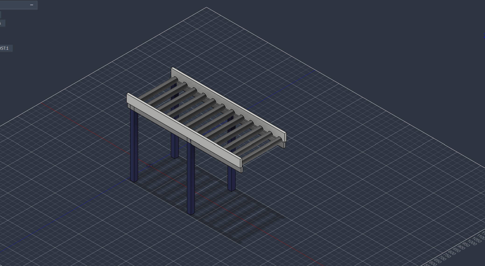

# Parametric-Sorting-Conveyor
Automated parametric conveyor framework for Autodesk Fusion 360 built with Python. Generates valid 3D CAD models with enforced design guardrails, revolute joint kinematics, physical material assignment, and real-time sorting simulations.

<div align="center">
  
#  Hyxon Parametric Sorting Conveyor Engine
**An API-driven CAD Generation & Kinematic Simulation Framework for Autodesk Fusion 360**

[](https://opensource.org/licenses/MIT)
[](https://www.autodesk.com/products/fusion-360/)
[](https://www.python.org/)
[]()

<p align="center">
  
</p>
</div>


## Table of Contents
- [Overview](#overview)
- [System Architecture](#system-architecture)
- [Key Features](#key-features)
- [Repository Structure](#repository-structure)
- [Installation Guide](#installation-guide)
- [Usage Workflow](#usage-workflow)
- [Engineering Constraints](#engineering-constraints)
- [Developed By](#developed-by)
- [License](#license)

---

## Overview

Developed by **Team Hyxon**, this project completely automates the design, validation, and simulation of industrial sorting conveyors inside **Autodesk Fusion 360**. By leveraging Fusion's Python API, the framework eliminates manual 2D sketching and keyframe animation, replacing it with a fully parametric math-driven engine.
<p align="center">
  
</p>

---

## System Architecture

The framework operates via two synchronized Python scripts communicating through embedded document metadata (`root.attributes`):

1. **The Generator (`src/Mechanism verifier.py`)**: Reads user input, computes exact mathematical 3D Boundary Representations (B-Rep), establishes As-Built Revolute Joints, and applies physical materials.
2. **The Physics Engine (`src/Animations.py`)**: Retrieves the metadata baked into the CAD file by the generator, computes the correct routing trajectory based on cargo weight, and drives real-time graphics rendering.

---

## Key Features

* **Zero-Sketch B-Rep Generation**: Mathematically computes components (frames, rollers, legs, guards) instantly.
* **Constraint Validation**: Failsafes prevent generation of mechanically invalid designs.
* **Automated Kinematics**: Auto-generates Revolute Joints for realistic physical motion.
* **Smart Weight-Based Routing**:
  * `Cargo > 10 kg` -> Routed **RIGHT**
  * `Cargo <= 10 kg` -> Routed **LEFT**
* **Material Injection Engine**: Dynamically fetches Physical Materials (*Oak*, *Stainless Steel*, *ABS Plastic*) with guaranteed RGB custom appearance fallbacks.
* **Live Analytics**: Built-in stopwatch generates a final logistics throughput report.

---

## Repository Structure

```text
Hyxon-Parametric-Sorting-Conveyor/
│
├── cad/                               # CAD Model Files
│   ├── conveyor.f3d                   # Autodesk Fusion 360 native archive
│   └── conveyor.step                  # Universal STEP interchange model
│
├── src/                               # Source Code Directory
│   ├── Mechanism verifier.py          # Parametric CAD generator script
│   ├── Mechanism verifier.manifest    # Fusion 360 manifest file
│   ├── Animations.py                  # Simulation and sorting engine script
│   └── Animations.manifest            # Fusion 360 manifest file
│
├── .gitignore                         # Git configuration file
├── CONTRIBUTING.md                    # Open-source contribution guidelines
├── LICENSE                            # MIT License
└── README.md                          # Main project documentation
```
## Installation Guide

### Prerequisites
* **Autodesk Fusion 360** (Latest Version)
* Basic familiarity with the Fusion 360 Scripts & Add-Ins environment.

### Setup
1. Clone this repository:
   ```bash
   git clone [https://github.com/Divyansh-dutt/Hyxon-Parametric-Sorting-Conveyor.git](https://github.com/Divyansh-dutt/Hyxon-Parametric-Sorting-Conveyor.git)
2. Open Autodesk Fusion 360.
3. Press Shift + S to open the Scripts and Add-Ins menu
4. Under the Scripts tab, click the + icon next to "My Scripts".
5. Navigate to the src/ folder of this repository and select both `Mechanism verifier.py` and `Animations.py`.

## Usage Workflow
### Phase 1: Model Generation

1. Launch `Mechanism verifier.py`.
2. Select a Configuration Preset (e.g., Config B - Medium) or enter custom dimensions.
3. Set the Cargo Weight (kg).
4. Click OK. The engine will instantly build the fully jointed 3D assembly.

### Phase 2: Sorting Simulation

1. Launch `Animations.py`.
2. Adjust the Animation Speed slider (1-10).
3. Click OK. Watch the cargo spawn, physical rollers spin, and the package intelligently sort itself based on the weight inputted during Phase 1.

## Engineering Constraints
| Parameter | Allowed Range | Description |
| :--- | :--- | :--- |
| **Length ($L$)** | 800 – 2000 mm | Total length of the conveyor |
| **Width ($W$)** | 300 – 600 mm | Span between left and right frames |
| **Height ($H$)** | 500 – 900 mm | Floor to conveyor surface height |
| **Roller Diameter ($D$)** | 40 – 80 mm | Outer diameter of sorting rollers |
| **Roller Spacing ($P$)** | 80 – 150 mm | Center-to-center distance |
| **Support Spacing ($S$)** | 500 – 1000 mm | Pitch between vertical support legs |
| **Side-Guard Height ($G$)**| 0 – 150 mm | Optional barrier height |


## Developed By
* **Team Hyxon**
Convergence of high-speed automation and intelligent CAD design.

## License
**Copyright © 2026 Team Hyxon. All Rights Reserved.**

This software and associated CAD algorithms are proprietary. Unauthorized copying, modification, distribution, or commercial use of this codebase or design methodology via any medium is strictly prohibited.****
